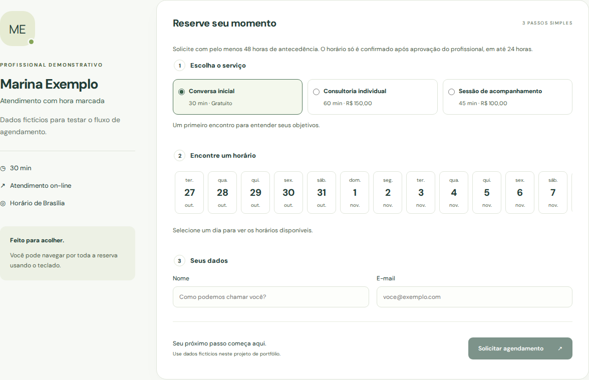
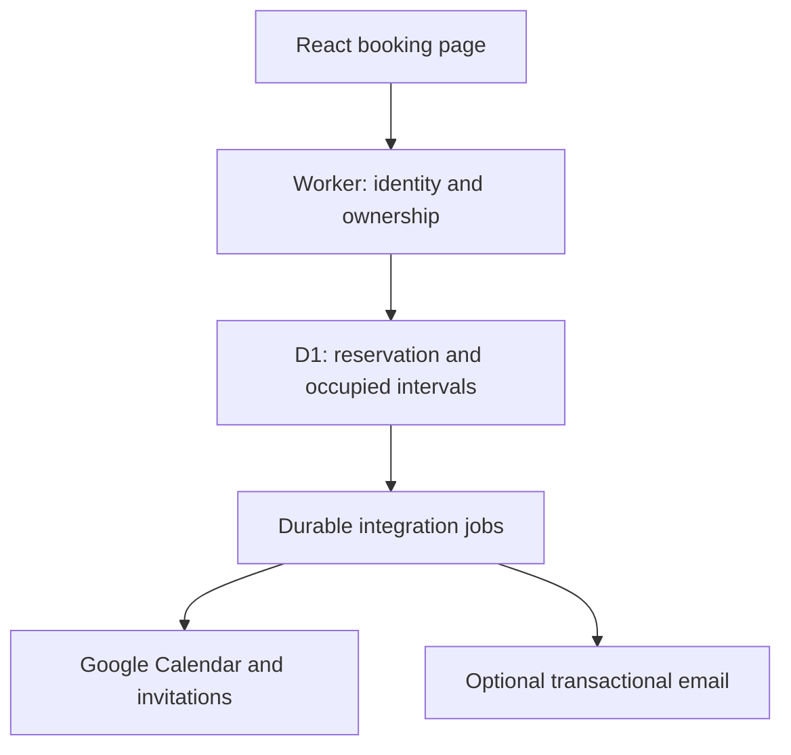

# Slotiva


**Horários livres que viram encontros.**

Appointment scheduling for independent professionals. Each professional has a
public booking page and a private agenda. Customers request a time without
creating an account; the professional approves or rejects the request.

Built with React, TypeScript, Vite, Cloudflare Workers and D1.

## Features

- Google sign-in, professional invitations and separate administrator access.
- Master management of active, suspended and deleted profiles, including restoration.
- Public pages at `/p/{slug}`, with editable branding, services and working hours.
- Optional WhatsApp contact configured and enabled by each professional.
- Booking requests with 48-hour notice and a 24-hour approval deadline.
- Direct entry of agreed appointments, including finite weekly or fortnightly series.
- Conflict protection in the database and cancellation history.
- Professional agenda views for Hoje, Futuros, Cancelados and Histórico, using Brasília dates.
- Separate Google Calendar consent and manual lookup of occupied intervals.

Calendar synchronization creates private events for confirmed bookings, requests
Google invitations, and propagates Slotiva cancellations. Explicit write consent
is required, including for previously connected accounts. External conflicts are
checked before approval and professional series creation; public availability also excludes busy Google intervals. Delivery failures appear separately from booking
status. Google event creation, invitations and cancellation were validated in Preview. Customer access survives reload through a booking-scoped HttpOnly browser cookie.
A short-lived, one-use link can transfer access to another device.
See the [roadmap](docs/ROADMAP.md).



## How a reservation reaches the calendar



D1 enforces occupied intervals and versioned decisions inside the same transaction.
Google and email delivery run afterwards with stable IDs and retries. A delivery
failure is visible separately from the booking status.

## Try an isolated demo

Run `npm run demo` and open `http://127.0.0.1:8788`. The professional login password
is `slotiva-demo-local`; set SLOTIVA_DEMO_PASSWORD to override it. The demo includes
fictional services, one confirmed appointment and one pending request. Google and
email delivery are disabled. Stop the server before `npm run demo:reset`.

The demo uses its own local storage and an unprovisioned D1 identifier; these
commands do not access Preview or production. `npm run backup:drill` verifies a
restored local copy. With Chromium installed, `npm run demo:capture` captures the
fictional public page. Operational details are in [Operations](docs/OPERATIONS.md).

## Local development

Requires Node.js 22.12+ or 24+.

```bash
npm ci
cp .dev.vars.example .dev.vars
npm run admin:hash
```

Copy the generated hash into `ADMIN_PASSWORD_HASH` in `.dev.vars`.
Keep `AUTH_MODE=demo` and `COOKIE_SECURE=false` for local HTTP.

```bash
npm run db:local
npm run dev:api
# In another terminal:
npm run dev
```

Open http://localhost:5173. Vite proxies API requests to Wrangler on port 8787.
The local demo uses a fictional professional and password login at `/admin`.

## Checks

```bash
npm run lint
npm run format:check
npm test
npm run test:worker
npm run build
node --test scripts/check-docs.test.mjs
node scripts/check-docs.mjs
```

Worker tests run against isolated D1 databases in Miniflare. For browser tests,
use a separate checkout with no `.dev.vars`:

```bash
npx playwright install chromium
node scripts/test-env.mjs
npm run db:local
npm run dev:api -- --var COOKIE_SECURE:false
# In another terminal:
npm run test:e2e
```

The fixture script creates the test password expected by Playwright. CI uses the
same isolated setup.

## Deployment

Frontend assets and the API share a Worker. Preview uses a separate D1 database.
Google credentials and the Calendar encryption key are server secrets.

`main` is connected to Cloudflare Builds. Schema changes must be coordinated
with the matching Worker version, particularly migrations 0006–0007, which
rebuild booking tables. See [operations](docs/OPERATIONS.md) before deploying.

[Architecture](docs/ARCHITECTURE.md) · [API](docs/API.md) ·
[Calendar setup](docs/CALENDAR_CONNECTION.md) · [Changelog](CHANGELOG.md) ·
[Contributing](CONTRIBUTING.md)
