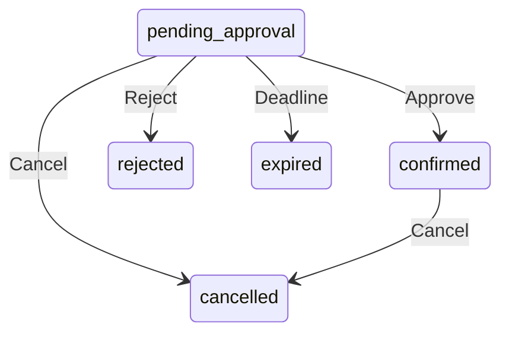

# Architecture

## One application on Cloudflare

React and Vite build the frontend. A TypeScript Worker serves the API and static
assets from the same origin; D1 stores application data. This keeps the deployment
small and avoids a separate API host and cross-origin session setup.

The first backend used FastAPI and PostgreSQL. It was replaced to keep the
application on Cloudflare; that implementation remains in Git through `c44ee77`.
D1 is the tradeoff: scheduling constraints that previously relied on PostgreSQL
now use SQL triggers and occupied intervals.

## Ownership

Each professional owns a public slug, branding, services, working hours and agenda.
The server resolves ownership from the public slug or authenticated session,
rather than accepting an owner ID in an administrative payload.

The master role manages professional accounts but cannot read their bookings.
Suspension hides the page and revokes sessions. Removal also cancels active
appointments and releases their intervals while retaining history. It does not
implement personal-data erasure. The master can restore a deleted profile under
the same identity. Cancelled bookings and revoked sessions stay unchanged;
Calendar requires new consent and WhatsApp publication starts hidden.

## Booking rules

A public request starts as `pending_approval`. Its start must be at least 48
elapsed hours away and within the next 14 calendar days. The professional has
24 elapsed hours to approve; at the deadline, expiration wins.

Pending customer edits retain the original deadline. Confirmed appointments
cannot be moved by the customer yet.

Professionals can also enter an appointment already agreed with a customer.
That path confirms immediately and supports 1–26 occurrences, once, weekly or
fortnightly, within 366 days. The public notice and approval rules do not apply
to these agreements. Working hours and conflict checks still apply.

## Agenda views

The professional agenda opens on Hoje. Noncancelled rows are grouped by their
Brasília calendar date: today, future dates and earlier history. Futuros filters
by a selected year/month, initially the next reservation's month, and retains the
choice when changing tabs. Its tab count includes all future months. Cancelados
contains cancellations regardless of date. Today/future rows sort chronologically;
history/cancellations show the latest date first. Past and cancelled rows have no
mutation controls. Grouping refreshes every 30 seconds and when the page regains
focus or visibility, so the day can change without a reload. Backend authorization
and scheduling rules are unchanged.

## Conflicts and retries

Availability reads help the user choose a time; database constraints decide
whether a reservation succeeds. Occupancy is scoped by professional, date and
interval. Triggers maintain it when bookings change, so overlapping concurrent
requests cannot both reserve the same professional.

Starts are offered every 30 minutes, with a 15-minute buffer in
`America/Sao_Paulo`. Series creation runs in a D1 batch: one conflict rolls back
the entire series. A request UUID deduplicates retries; changed data with the same
UUID is rejected.

Services have versions. A booking snapshots its service name, description,
duration and price so later catalog edits do not rewrite an existing agreement.
A service without a fixed duration stays visible but requires the professional
to enter a concrete duration before reserving time.

## Authentication

Hosted access uses server-side Google authorization code flow with PKCE, nonce
and one-use state. The server checks signed claims, then separately checks the
account's role and active status. A Google account alone does not grant access.
Professional invitations can bind a verified authoritative Gmail/Workspace
address to its Google subject; other domains need explicit subject provisioning.

Sessions last eight hours. Their random tokens are hashed in D1 and sent through
HttpOnly, SameSite cookies; hosted cookies are Secure. Mutations check Origin.
Password login is available only in local/demo mode.

Customers use a random booking capability sent in `X-Cancel-Token`. Only its
hash is stored. New public bookings also grant a 30-day, booking-scoped browser
session through an HttpOnly cookie. Recovery links are hashed, single-use and
expire after 30 minutes; redemption grants access only to the named reservation.
Email or phone alone must not be treated as proof of ownership.

## Integrations

Calendar authorization is separate from sign-in. Free/busy and owned-event write
scopes require explicit consent from the same Google account. Old read-only grants
remain usable for lookup until upgraded. See [Calendar](CALENDAR_CONNECTION.md).

Booking triggers atomically queue Calendar jobs for confirmations and subsequent
cancellations. A bounded consumer uses leases, stable event IDs and version guards.
It runs after API mutations, on the five-minute scheduled handler and through the
professional's manual sync action. Existing future confirmations are backfilled.
Google and D1 do not share a transaction: remote conflicts or delivery failures
leave the booking intact and expose a separate retry state. Cancellation racing
with an insert is compensated on a later pass. The older notification outbox still
records intent for standalone transactional email; it is not an email sender.

## Client contacts

Public reservations keep separate client records even when addresses match.
A professional series has an explicit shared client identity. Versioned assignment
can consolidate known records without changing customer authorization. Mailbox
proof belongs to an emailed-link redemption and is valid only for the current
address of a linked booking; it is not a global account or a person-identity check.
Archiving preserves booking history. Data exports omit capabilities, credential
hashes and provider secrets. Deletion requests require professional review under
the agreed retention policy; no medical retention period is assumed by the code.
